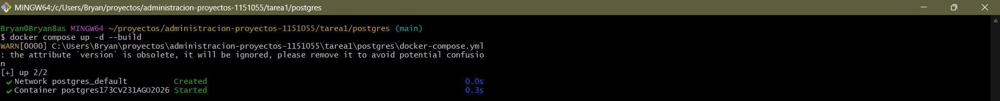
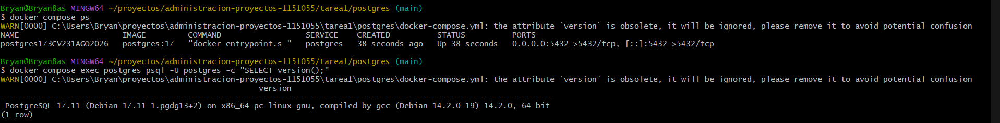
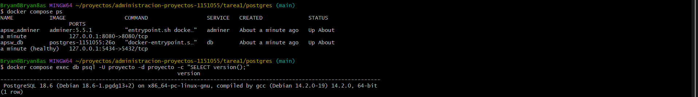
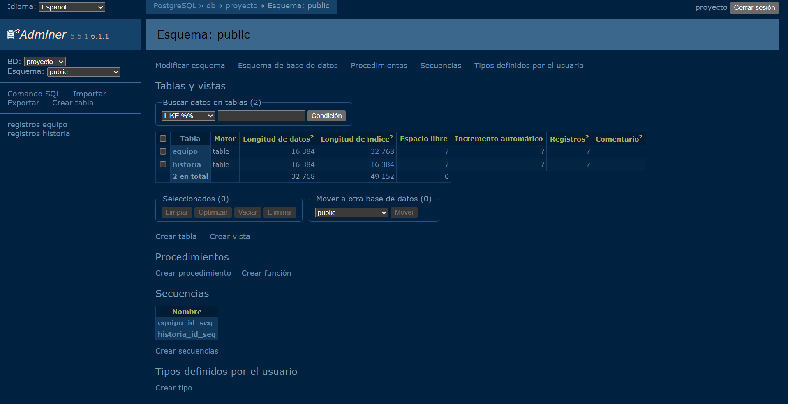
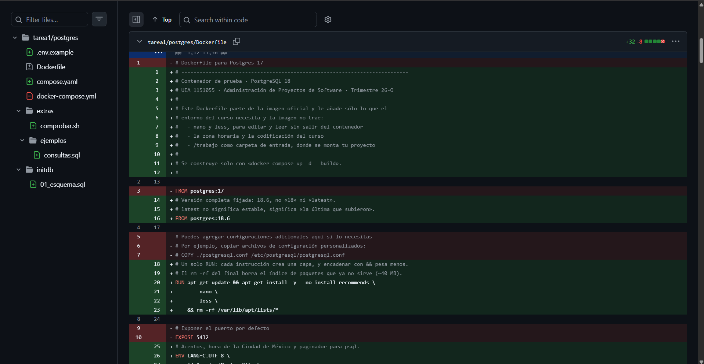
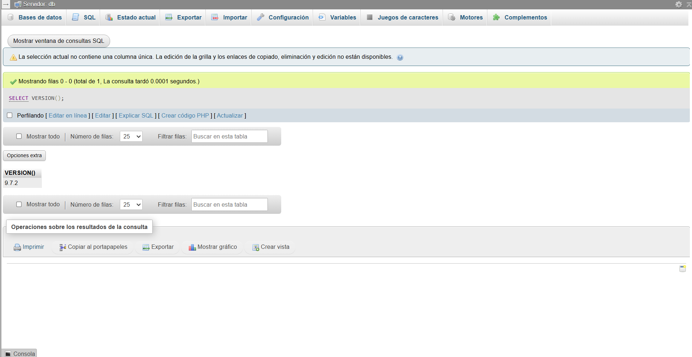
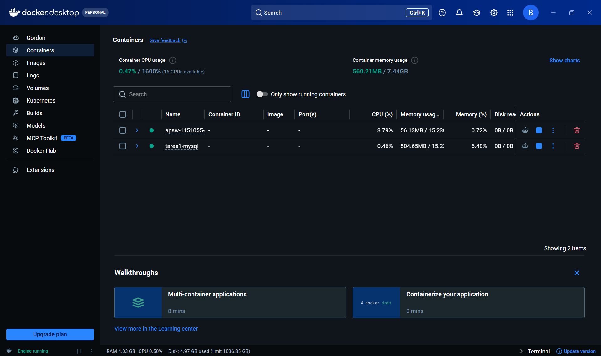
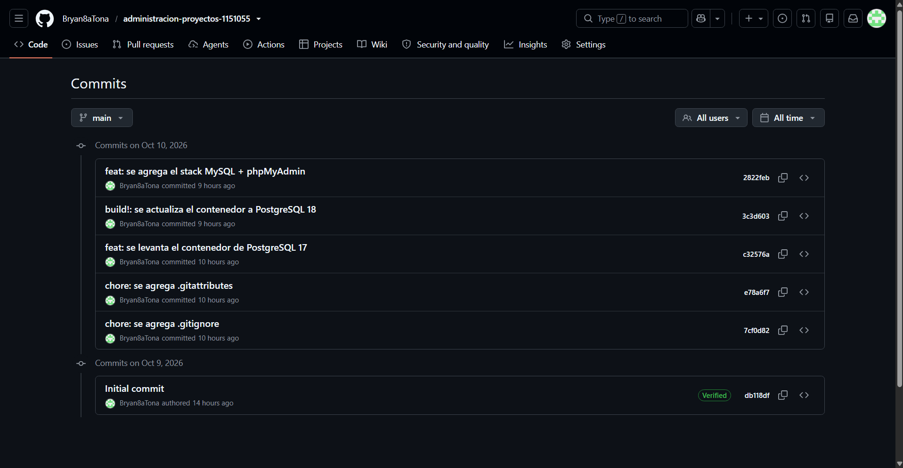

# Tarea 1 · Introducción a la administración de proyectos y entorno de trabajo

| | |
|---|---|
| **UEA y clave** | Administración de Proyectos de Software (1151055) |
| **Trimestre** | 26-O, otoño 2026 |
| **Licenciatura** | Ingeniería en Computación |
| **Nombre** | Bryan Tonatiuh Ochoa De La Cruz |
| **Matrícula** | 2223028771 |
| **Profesor** | Gabriel Hurtado Avilés |
| **Fecha** | 10 de octubre de 2026 |

## Contenido

1. [¿Qué es un proyecto de software?](#1-qué-es-un-proyecto-de-software)
2. [¿Cómo se administra?](#2-cómo-se-administra)
3. [¿Con qué herramientas?](#3-con-qué-herramientas)
4. [¿Bajo qué licencia se distribuye el software?](#4-bajo-qué-licencia-se-distribuye-el-software)
5. [De PostgreSQL 17 a 18](#5-de-postgresql-17-a-18)
6. [Otro stack: MySQL + phpMyAdmin](#6-otro-stack-mysql--phpmyadmin)
7. [Historial de confirmaciones](#7-historial-de-confirmaciones)
8. [Uso de inteligencia artificial](#8-uso-de-inteligencia-artificial)
9. [Referencias](#referencias)

---

## 1. ¿Qué es un proyecto de software?

Un proyecto de software es un esfuerzo temporal, con un principio y un final definidos, para crear o modificar un sistema de software (Gómez Fuentes et al., 2012, p. 31). Lo que lo distingue de simplemente "programar algo" es que tiene un objetivo concreto, un equipo, una fecha y recursos limitados. Cuando el objetivo se cumple, el proyecto termina, aunque el software se siga usando.

### Proyecto frente a operación continua

La diferencia es que la operación no termina: se repite mientras la organización la necesite. Esta misma tarea lo muestra bien. Actualizar el contenedor de PostgreSQL 17 a 18 es un proyecto, porque tiene un objetivo único y una fecha de entrega. Mantener esa base respaldada y con parches cada mes sería operación.

| | Proyecto | Operación continua |
|---|---|---|
| Duración | Temporal: tiene un principio y un final definidos | Permanente: se repite mientras se necesite |
| Resultado | Único (un sistema nuevo, una migración, una versión) | Repetitivo (mantener un servidor, atender soporte) |
| Ejemplo en esta tarea | Pasar de PostgreSQL 17 a 18 | Respaldar la base y aplicar parches menores |

Es como un relevo: el proyecto construye algo y, al terminar, se lo entrega a la operación, que lo mantiene funcionando. Cuando ese sistema necesite un cambio grande, como la próxima versión mayor de PostgreSQL, empezará otro proyecto.

### Proyecto, producto y proceso

Los tres se confunden con facilidad, pero responden a preguntas distintas:

- **Producto: ¿qué se entrega?** No son sólo los programas. También cuentan los datos y la documentación necesaria para operarlo y mantenerlo (Gómez Fuentes et al., 2019, pp. 14, 19). En esta tarea, el producto no es sólo que los contenedores funcionen en mi computadora: también lo son los `Dockerfile`, los `compose.yaml` y este README, porque sin ellos nadie más podría levantar el mismo entorno.
- **Proceso: ¿cómo se produce?** Es el conjunto ordenado de actividades que se siguen para construir el sistema (Gómez Fuentes et al., 2019, p. 20). Aquí el proceso fue el de la guía: levantar, comprobar, confirmar en Git y documentar, en cada fase.
- **Proyecto: ¿con quién, cuándo y con qué recursos?** Es el esfuerzo concreto que aplica un proceso para obtener un producto. Un mismo proceso, como Scrum, sirve para muchos proyectos distintos, y un mismo producto pasa por varios proyectos a lo largo de su vida.

### Alcance, tiempo, costo y calidad

Son las cuatro variables con las que se juzga si un proyecto salió bien: entregar lo que se pidió, a tiempo y dentro del presupuesto (Gómez Fuentes et al., 2012, p. 7), con la calidad necesaria, que es justamente el fin de la ingeniería de software (Gómez Fuentes et al., 2019, p. 14).

Lo importante es que están amarradas: si una cambia, otra tiene que ajustarse. Si se agregan funciones (más alcance), hace falta más tiempo o más gente, o baja la calidad. En esta tarea el tiempo y el alcance estaban fijos (una fecha límite y una lista de ejercicios), así que lo único que podía moverse era el esfuerzo, es decir, las horas de trabajo.

| Restricción | Pregunta que responde | En esta tarea |
|---|---|---|
| Alcance | ¿Qué se entrega? | Repositorio, dos contenedores, README e investigación |
| Tiempo | ¿Para cuándo? | Sábado 10 de octubre de 2026, 23:59 h |
| Costo | ¿Con qué recursos? | Horas de trabajo; software libre sin costo de licencia |
| Calidad | ¿Qué tan bien debe funcionar? | Los contenedores deben levantar y verificarse con `ps` y la versión |

---

## 2. ¿Cómo se administra?

Un proyecto se administra planificando lo que se va a hacer y dándole seguimiento para corregir el rumbo a tiempo, con los recursos que se tienen (Gómez Fuentes et al., 2012, p. 7). Para eso hay dos tipos de apoyo: guías generales que dicen qué atender, como el PMBOK, y marcos de trabajo concretos que dicen cómo organizarse, como Scrum.

### La Guía del PMBOK

Es el estándar del Project Management Institute (PMI), la organización de referencia mundial en administración de proyectos, y reúne los fundamentos para dirigir cualquier tipo de proyecto (Gómez Fuentes et al., 2012, p. 12). No está pensada sólo para software, por eso habla de documentos generales como el acta de constitución o el enunciado del alcance (Gómez Fuentes et al., 2012, p. 38). Es más como una lista de qué revisar que como una receta de cómo hacerlo.

### Scrum

Scrum es un marco de trabajo ligero para resolver problemas complejos entregando valor en ciclos cortos. Se apoya en tres pilares: transparencia, inspección y adaptación, y se organiza con los siguientes elementos (Schwaber y Sutherland, 2020):

| Elemento | Qué incluye |
|---|---|
| Equipo Scrum | Product Owner (decide qué aporta más valor), Scrum Master (cuida que el equipo trabaje bien) y Developers (construyen el producto) |
| Eventos | Sprint (un mes o menos), Sprint Planning, Daily Scrum, Sprint Review y Sprint Retrospective |
| Artefactos | Product Backlog, Sprint Backlog e Incremento |

### En qué se distinguen

El PMBOK dice **qué** hay que cuidar en un proyecto: alcance, riesgos, interesados, costos. Scrum dice **cómo** trabajar día a día: quién decide, cada cuándo se revisa y cómo se entrega. Por eso no compiten. Un equipo puede usar Scrum para organizar su trabajo y apoyarse en el PMBOK para no olvidar temas que Scrum no toca, como el presupuesto o el acta de constitución.

### Modelos predictivo, iterativo y ágil

La diferencia entre los tres está en **cuándo se decide qué se construye** y **cada cuánto se entrega algo que funciona**.

| Modelo | Cómo funciona | Cuándo conviene |
|---|---|---|
| **Predictivo** (cascada) | Todo se planea al inicio y las fases van una tras otra, separadas; el producto se entrega al final (Gómez Fuentes et al., 2012, p. 44) | Cuando los requisitos son claros y estables (Gómez Fuentes et al., 2012, p. 50) |
| **Iterativo** (evolutivo) | Se construye una primera versión y se mejora en vueltas sucesivas (Gómez Fuentes et al., 2012, p. 44) | Cuando los requisitos se van aclarando conforme se avanza |
| **Ágil** | Ciclos muy cortos, iterativos e incrementales, que dan más peso a adaptarse al cambio que a seguir un plan fijo (Gómez Fuentes et al., 2012, pp. 48–49) | Con mucha incertidumbre, cambios frecuentes y equipos pequeños |

El riesgo del modelo predictivo es que un error en los requisitos se descubre hasta el final, cuando corregirlo es más caro. Los modelos iterativo y ágil reducen ese riesgo porque muestran avances desde temprano. Aun así, no hay un modelo mejor en general: el ciclo de vida se elige según el proyecto (Gómez Fuentes et al., 2012, p. 51). Esta misma tarea fue predictiva, y estuvo bien que lo fuera: los requisitos estaban claros desde el principio y la guía fijó las fases (A, B y C) de antemano.

### ¿Cuál elegiría para el proyecto del curso?

Elegiría **Scrum**, adaptado al calendario del trimestre:

- Al trimestre le restan alrededor de 7 semanas, así que caben sprints de una semana, cada uno con un avance que el profesor puede revisar.
- Los requisitos del proyecto se van a aclarar sobre la marcha, y Scrum está hecho justamente para inspeccionar y adaptar (Schwaber y Sutherland, 2020).
- El equipo es pequeño y puede repartirse los roles de Product Owner, Scrum Master y Developers.

Como las entregas del curso tienen fechas fijas, en la práctica sería un enfoque **híbrido**: las fechas del profesor funcionan como hitos predictivos, y el trabajo entre un hito y otro se organiza en sprints.

---

## 3. ¿Con qué herramientas?

Cada herramienta resuelve un problema distinto de trabajar en equipo: no perder cambios, saber quién hace qué, que el programa funcione igual en todas las computadoras y detectar errores pronto. En conjunto, su objetivo es aumentar la productividad del equipo durante el proyecto (Gómez Fuentes et al., 2012, p. 15).

### Para qué sirve cada tipo de herramienta

| Herramienta | Para qué sirve | Ejemplo |
|---|---|---|
| **Control de versiones** | Guarda cada cambio de los archivos, con quién lo hizo, cuándo y por qué, y permite volver a cualquier versión anterior. Es parte de la gestión de la configuración, que se encarga de controlar las versiones del software (Gómez Fuentes et al., 2019, p. 18). En esta tarea, el historial de Git muestra paso a paso el cambio de PostgreSQL 17 a 18 y luego a MySQL | Git y GitHub |
| **Tablero de trabajo** | Hace visible el estado de cada tarea (pendiente, en curso, terminada), para que todo el equipo sepa qué falta y quién se encarga | GitHub Projects, Jira |
| **Contenedores** | Empaquetan una aplicación con todo lo que necesita para correr, de modo que funcione igual en cualquier computadora. Evitan el clásico "en mi máquina sí funciona" | Docker |
| **Integración continua** | Cada vez que alguien sube cambios, el proyecto se compila y se prueba automáticamente, y los errores se detectan en cuanto aparecen y no días después | GitHub Actions |

### Docker frente a una máquina virtual

Un contenedor es mucho más ligero que una máquina virtual porque sólo aísla el proceso de la aplicación y comparte el kernel del sistema anfitrión, mientras que la máquina virtual carga un sistema operativo completo, con su propio kernel (Docker Inc., s.f.-b). En esta tarea se vio en la práctica: los dos stacks, con cuatro contenedores, corrieron al mismo tiempo sin problema. Con cuatro máquinas virtuales habría hecho falta muchísima más memoria.

| | Máquina virtual | Contenedor Docker |
|---|---|---|
| Qué virtualiza | Una computadora completa | Sólo el proceso de la aplicación |
| Sistema operativo | Uno completo, con kernel, controladores y programas | Comparte el kernel del anfitrión |
| Tamaño | Gigabytes | Megabytes a cientos de megabytes |
| Arranque | Minutos | Segundos |

Un detalle: en Windows, Docker Desktop sí usa una máquina virtual ligera (WSL 2) para tener un kernel Linux, pero es una sola, y todos los contenedores la comparten.

### Dockerfile frente a compose.yaml

El Dockerfile es la receta para **construir una imagen**; el `compose.yaml` es el plan para **ejecutar** uno o varios contenedores juntos, con sus puertos, volúmenes y variables.

| | Dockerfile | compose.yaml |
|---|---|---|
| Qué describe | Cómo construir una imagen, capa por capa | Cómo ejecutar una aplicación de uno o varios contenedores |
| Instrucciones típicas | `FROM`, `RUN`, `ENV`, `WORKDIR` | `services`, `image`, `build`, `ports`, `volumes`, `environment`, `healthcheck`, `depends_on` |
| En esta tarea | Parte de `postgres:18.6` y le agrega `nano`, `less`, zona horaria y `/trabajo` | Levanta la base y Adminer, con su volumen, puertos y chequeo de salud |

El Dockerfile sólo se usa si el servicio del `compose.yaml` tiene la clave `build:`. Si sólo tiene `image:`, Compose descarga la imagen ya hecha, que es justo lo que pasaba con el contenedor viejo (ver 5.2).

### El volumen

Un volumen es un espacio de datos que Docker administra aparte del contenedor: si se borra el contenedor, los datos siguen ahí. Por eso la base no se pierde al hacer `docker compose down`, pero sí con `docker compose down -v`, que borra también el volumen. En esta tarea, PostgreSQL 17 guardaba los datos en una carpeta del proyecto (`./data`) y PostgreSQL 18 en un volumen con nombre (`datos_db`).

### Comandos del curso

Estos son los comandos de Docker Compose que se usaron en la tarea (Docker Inc., s.f.-a):

| Comando | Qué hace |
|---|---|
| `docker compose up -d` | Crea y arranca los contenedores; `-d` los deja en segundo plano y devuelve la terminal |
| `docker compose exec` | Ejecuta un comando dentro de un contenedor que ya está corriendo, por ejemplo `psql` |
| `docker compose stop` | Detiene los contenedores sin borrarlos |
| `docker compose down` | Detiene y borra los contenedores y la red del proyecto (los volúmenes, sólo con `-v`) |
| `docker compose ps` | Lista los contenedores del proyecto y su estado, incluido `(healthy)` |
| `docker compose logs` | Muestra la salida de los contenedores; sirve para ver por qué algo no arranca |

---

## 4. ¿Bajo qué licencia se distribuye el software?

Una licencia de software es el permiso con el que el autor dice qué puede hacer con su programa quien lo recibe (usarlo, modificarlo, redistribuirlo, venderlo) y con qué obligaciones. En el código abierto hay dos grandes familias, y lo que las separa es qué pasa cuando alguien modifica el programa y lo vuelve a distribuir (GitHub, s.f.):

- **Permisivas** (MIT, BSD, Apache 2.0): casi no ponen condiciones. Se puede usar el código hasta dentro de un programa cerrado; basta con conservar el aviso de copyright.
- **Copyleft** (GPL, LGPL, AGPL): dan las mismas libertades, pero con una condición. Quien distribuya una versión modificada debe hacerlo con la misma licencia y publicar su código fuente. Así, el software y sus derivados siguen siendo libres.

Yo lo resumiría así: las permisivas cuidan la libertad de **quien recibe** el código, y las copyleft cuidan la libertad **del código mismo**.

### 4.1 Lo que permite y exige cada una

La siguiente tabla resume las condiciones de cada licencia según GitHub (s.f.):

| Licencia | Tipo | Permite | Exige |
|---|---|---|---|
| **MIT** | Permisiva | Uso comercial, modificación, distribución y uso privado | Conservar el aviso de copyright y el texto de la licencia |
| **BSD 3-Clause** | Permisiva | Uso comercial, modificación, distribución y uso privado | Conservar el aviso de copyright; no usar el nombre de los autores para promocionar productos derivados sin permiso |
| **Apache 2.0** | Permisiva | Lo mismo que MIT, más una licencia expresa sobre las patentes de los contribuyentes | Conservar el aviso y la licencia, e indicar los cambios hechos |
| **GPL v3** | Copyleft fuerte | Uso comercial, modificación, distribución, uso privado y patentes | Al distribuir, publicar el código fuente, usar la misma licencia e indicar los cambios |
| **LGPL v3** | Copyleft débil | Lo mismo que la GPL, y además enlazar la biblioteca desde programas con otra licencia, incluso cerrados | Las modificaciones **a la biblioteca** quedan bajo LGPL con su código; el programa que sólo la usa no |
| **AGPL v3** | Copyleft de red | Lo mismo que la GPL | Lo mismo que la GPL, y además ofrecer el código a quien use el programa **a través de la red** |

Además, ninguna de ellas ofrece garantía ni hace responsable al autor de los daños.

### 4.2 Por qué este repositorio usa MIT

Se eligió MIT porque este repositorio es material de aprendizaje: archivos de configuración, un README y comandos que cualquiera puede querer copiar.

- **Ventajas:** es corta y fácil de entender. Cualquiera (un compañero, otra materia, una empresa) puede reutilizar los `compose.yaml` y el texto sin pedirme permiso, con la única condición de conservar el aviso de copyright. Además es compatible con casi cualquier otra licencia, incluida la GPL.
- **Qué cambiaría con GPL:** quien modificara y distribuyera mi trabajo tendría que publicar su versión con el código fuente y bajo la misma GPL. Eso protege que las mejoras sigan siendo libres, pero impide usar el material en un proyecto cerrado. Para archivos de configuración de práctica, esa protección no aporta mucho y sí agrega obligaciones.

### 4.3 Caso real: MySQL, Oracle y MariaDB

Cuando Oracle compró Sun Microsystems, se quedó también con MySQL. Varios de sus desarrolladores originales temieron que Oracle, que vendía su propia base de datos comercial, frenara el desarrollo abierto de MySQL, y crearon MariaDB a partir del mismo código ("MariaDB", s.f.):

| Año | Hecho |
|---|---|
| 2008 | Sun Microsystems compra MySQL AB, la empresa creadora de MySQL |
| 2009 | Oracle, dueña de Oracle Database (competidor directo de MySQL), anuncia la compra de Sun |
| 2009 | Michael "Monty" Widenius, uno de los creadores de MySQL, bifurca el código con otros desarrolladores originales y crea **MariaDB**; la primera versión sale el 29 de octubre |
| 2012 | Se crea la MariaDB Foundation |
| 2013-2017 | Fedora, openSUSE, Arch Linux, Red Hat Enterprise Linux 7 y Debian 9, entre otras distribuciones, sustituyen MySQL por MariaDB |

**Qué licencia tenía:** el servidor MySQL se distribuía bajo la **GPL versión 2**, además de una licencia comercial para quien no quisiera cumplir la GPL ("MariaDB", s.f.).

**Por qué la licencia permitió que MariaDB existiera sin pedir permiso:** la GPL le da a **cualquiera** que reciba el programa el derecho de estudiarlo, modificarlo y redistribuirlo (GitHub, s.f.), y ese permiso no se puede retirar del código que ya se publicó. Oracle se quedó con el copyright y con la marca, pero no podía impedir que alguien tomara el código GPL y lo siguiera desarrollando por su cuenta.

Lo único que la licencia no cubre es la marca. Por eso el proyecto nuevo tuvo que llamarse distinto: MariaDB, por la hija menor de Monty, igual que MySQL se llamaba así por su hija My ("MariaDB", s.f.). Lo que más me llama la atención es que la GPL funcionó en los dos sentidos: permitió la bifurcación y, por ser copyleft, obligó a que MariaDB también quedara bajo GPL. La misma licencia que dejó nacer a MariaDB garantiza que nadie pueda cerrarla después.

---

## 5. De PostgreSQL 17 a 18

Las dos fases están en [`postgres/`](postgres/) y en dos confirmaciones separadas: primero el contenedor del 22 de septiembre (PostgreSQL 17) y después el nuevo (PostgreSQL 18). Las dos se comprobaron igual: con `docker compose ps` (¿está prendido?) y con `SELECT version();` (¿es la versión correcta?).











### 5.1 Diferencias entre los dos contenedores

| Aspecto | Qué decía (17) | Qué dice (18) | Por qué cambió |
|---|---|---|---|
| Nombre del archivo | `docker-compose.yml` | `compose.yaml` | `compose.yaml` es el nombre que recomienda la especificación de Compose; `docker-compose.yml` es el nombre antiguo, de cuando Compose era un programa aparte |
| Primera línea | `version: '3.8'` | No hay | La clave `version` es obsoleta: Compose V2 la ignora y muestra un aviso. Es el `WARN` de la captura 1 |
| Nombre del proyecto | No tenía (Compose usaba el nombre de la carpeta) | `name: apsw-1151055-contenedor` | Con un nombre fijo, el proyecto se llama igual en todas las computadoras y no se duplican contenedores |
| Imagen | `image: postgres:17` en el compose | `FROM postgres:18.6` en el Dockerfile, más `build: .` e `image: postgres-1151055:26o` | Ahora la imagen se construye: se le agregan `nano`, `less`, zona horaria y codificación. Además se fija la versión completa (18.6) para que todos usen exactamente la misma; `17` a secas cambia sola con cada versión menor |
| Servicio | `postgres` | `db` | Nombre genérico: Adminer se conecta al servidor `db`, igual que phpMyAdmin en el stack de MySQL |
| Nombre del contenedor | `postgres173CV231AGO2026` | `apsw_db` y `apsw_adminer` | Nombres cortos y estables para el curso |
| Datos | `./data:/var/lib/postgresql/data` (carpeta del proyecto) | `datos_db:/var/lib/postgresql` (volumen con nombre) | La imagen 18 cambió la ruta de los datos y el punto de montaje a `/var/lib/postgresql`; montar la ruta vieja con la 18 impide que arranque. El volumen con nombre, además, deja los datos fuera de la carpeta del repositorio |
| Usuario y base | `postgres` / `postgres` | `proyecto` / `proyecto` | Un usuario y una base con el nombre del proyecto, en lugar de los genéricos `postgres` que crea la imagen por defecto |
| Contraseña | Escrita: `postgres` | `${POSTGRES_PASSWORD:-practica_local_26o}` | Se lee de un `.env` que no se sube al repositorio; el valor por defecto sólo permite que la práctica levante sin preparar nada. El `.env.example` documenta qué variables hacen falta |
| Codificación | No se indicaba | `POSTGRES_INITDB_ARGS: "--encoding=UTF8 --locale=C"` | Que la base ordene y guarde texto igual en todas las computadoras del equipo |
| Puerto | `"5432:5432"` | `"127.0.0.1:5434:5432"` | `127.0.0.1` publica el puerto sólo en esta máquina y no en la red local; el 5434 evita chocar con un PostgreSQL instalado en el 5432 |
| ¿Sabe si está lista? | No | `healthcheck` con `pg_isready` | Compose sabe cuándo la base acepta conexiones (`(healthy)`) y Adminer espera a ese estado con `depends_on: condition: service_healthy` |
| Datos de prueba | No | `./initdb:/docker-entrypoint-initdb.d:ro` | El script `01_esquema.sql` crea las tablas `equipo` e `historia`; la imagen lo ejecuta sólo cuando el volumen está vacío |
| Interfaz web | No | Adminer (`adminer:5.5.1`) en el puerto 8080 | Ver y consultar la base desde el navegador sin instalar nada |
| Carpeta del proyecto dentro | No, sólo `data/` | `./:/trabajo` y `working_dir: /trabajo` | Dentro del contenedor se ven los mismos archivos del proyecto, por ejemplo para ejecutar `extras/comprobar.sh` |
| `.env.example`, `initdb/`, `extras/` | No existían | Nuevos | Documentar variables, cargar datos de prueba y comprobar el entorno |

### 5.2 ¿Se usaba el Dockerfile viejo?

**No.** En el `docker-compose.yml` viejo el servicio sólo tiene `image: postgres:17` y **no tiene la clave `build:`**:

```yaml
services:
  postgres:
    image: postgres:17
    container_name: postgres173CV231AGO2026
```

Sin `build:`, Compose no lee ningún Dockerfile: descarga la imagen oficial `postgres:17` de Docker Hub y crea el contenedor con ella. Por eso, aunque se ejecutó `docker compose up -d --build`, no había nada que construir. Se nota en `docker compose ps`: la columna IMAGE dice `postgres:17`, la imagen oficial, y no una imagen propia. Además, aunque se hubiera usado, ese Dockerfile no agregaba nada: sólo tenía `FROM postgres:17` y `EXPOSE 5432`, que es documentación y no publica ningún puerto.

En el contenedor nuevo sí se usa: `build: .` le dice a Compose que construya con el Dockerfile de la carpeta, y `image: postgres-1151055:26o` es el nombre que recibe la imagen construida, que es lo que aparece en `docker compose ps`.

### 5.3 Versionado semántico y por qué de la 17 a la 18 es un cambio mayor

El **versionado semántico** usa números con la forma **MAYOR.MENOR.PARCHE** y dice cuál se incrementa según el tipo de cambio (Preston-Werner, s.f.):

- **MAYOR** cuando se hacen cambios incompatibles con la versión anterior.
- **MENOR** cuando se agrega funcionalidad compatible con la anterior.
- **PARCHE** cuando se corrigen errores de forma compatible.

Así, con sólo ver el número, quien usa el software sabe si puede actualizar sin riesgo (un parche o una menor) o si debe revisar qué se rompe (una mayor).

PostgreSQL usa una variante de dos números desde la versión 10: el primero es la versión **mayor** y el segundo la **menor**; 18.6 es la sexta versión menor de la 18 (PostgreSQL Global Development Group, s.f.). Pasar de la 17 a la 18 es un cambio mayor porque **no es compatible hacia atrás**:

1. **Los datos no se pueden abrir directamente.** Las versiones mayores cambian el formato del directorio de datos, así que para actualizar se necesita exportar e importar la base (`pg_dump`) o usar `pg_upgrade`. Una versión menor, en cambio, sólo requiere cambiar los binarios y reiniciar (PostgreSQL Global Development Group, s.f.).
2. **La imagen de Docker cambió su configuración.** En la 18 cambiaron la ruta de los datos y el punto de montaje del volumen; un `compose` escrito para la 17 no funciona con la imagen 18 sin modificarlo.

Por eso la confirmación se escribió como `build!: actualiza el contenedor a PostgreSQL 18`: en la convención de *Conventional Commits*, el `!` marca un cambio que rompe la compatibilidad, igual que el incremento del número MAYOR.

---

## 6. Otro stack: MySQL + phpMyAdmin

El stack está en [`mysql/compose.yaml`](mysql/compose.yaml), con los 11 huecos de la plantilla llenos según la tabla de equivalencias de la guía. Se comprobó con `docker compose ps` (`(healthy)`) y con `SELECT VERSION();` en phpMyAdmin.





### 6.1 PostgreSQL + Adminer frente a MySQL + phpMyAdmin

| Concepto | PostgreSQL + Adminer | MySQL + phpMyAdmin |
|---|---|---|
| Nombre del proyecto | `apsw-1151055-contenedor` | `tarea1-mysql` |
| Imagen de la base | `postgres:18.6` (construida como `postgres-1151055:26o`) | `mysql:9.7.2` (oficial, sin construir) |
| ¿Usa Dockerfile? | Sí, para agregar herramientas y configuración | No: la imagen oficial ya trae lo necesario |
| Contenedores | `apsw_db` y `apsw_adminer` | `tarea1_mysql` y `tarea1_phpmyadmin` |
| Contraseña del administrador | `POSTGRES_PASSWORD` (el usuario creado es el superusuario) | `MYSQL_ROOT_PASSWORD`, obligatoria |
| Base, usuario y contraseña | `POSTGRES_DB`, `POSTGRES_USER`, `POSTGRES_PASSWORD` | `MYSQL_DATABASE`, `MYSQL_USER`, `MYSQL_PASSWORD` |
| Puerto interno | 5432 | 3306 |
| Puerto en mi máquina | `127.0.0.1:5434` | `127.0.0.1:3307` |
| Carpeta de datos | `/var/lib/postgresql` | `/var/lib/mysql` |
| Volumen | `datos_db` | `datos_mysql` |
| Chequeo de salud | `pg_isready` | `mysqladmin ping` |
| Datos de prueba | Sí, con `initdb/01_esquema.sql` | No |
| Interfaz web | `adminer:5.5.1`, un solo archivo PHP que se conecta a varios motores (PostgreSQL, MySQL, SQLite…) | `phpmyadmin:5.2.3`, especializada en MySQL y MariaDB |
| Puerto web | Interno 8080 → `localhost:8080` | Interno 80 → `localhost:8081` |
| Cómo se le indica el servidor | `ADMINER_DEFAULT_SERVER: db` | `PMA_HOST: db` |
| Esperar a la base | `condition: service_healthy` | `condition: service_healthy` |
| Primer arranque | Unos segundos | Casi un minuto |
| Licencia de la base | PostgreSQL License (permisiva, tipo BSD) | GPL v2 o licencia comercial (ver 4.3) |

Los dos stacks pueden estar encendidos a la vez porque no comparten nombres de contenedor, volúmenes ni puertos en la máquina.

### 6.2 LTS frente a innovation, y por qué `mysql:9.7.2` y no `mysql:latest`

MySQL publica dos líneas de versiones (Frank, 2026):

| | Innovation | LTS (*Long-Term Support*) |
|---|---|---|
| Qué trae | Funciones nuevas, correcciones y parches de seguridad | Sólo las correcciones necesarias, para no cambiar el comportamiento |
| Soporte | Corto: hasta que sale la siguiente versión | Largo: varios años |
| Para quién | Equipos con muchas pruebas automáticas que actualizan seguido | Entornos que necesitan un comportamiento estable |

En 2026, MySQL cambió además a números de versión por año y mes: después de la LTS 9.7, las versiones *innovation* se numeran 26.7.0, 26.10.0, etc. (Frank, 2026). Hoy, `mysql:latest` descarga la **26.7.0** (*innovation*), mientras que la **9.7.2** es la LTS.

Se usa `mysql:9.7.2` y no `mysql:latest` por tres razones:

1. **`latest` no es fija.** Hoy es la 26.7.0 y en unos meses será otra, así que el mismo `compose.yaml` levantaría versiones distintas según el día. Con 9.7.2 todo el equipo y el profesor obtienen exactamente la misma versión.
2. **`latest` es una versión *innovation*, de soporte corto.** Habría que actualizar en cada lanzamiento para seguir recibiendo parches, y una actualización podría cambiar el comportamiento de la base en medio del trimestre.
3. **La LTS se mantiene por años y sólo recibe correcciones**, que es lo que conviene para un proyecto que necesita estabilidad. Se fija hasta el número de parche (9.7.2) por la misma razón que `postgres:18.6`: reproducibilidad.

---

## 7. Historial de confirmaciones

En el historial se ven, en orden, las confirmaciones de PostgreSQL 17, PostgreSQL 18 y MySQL:



---

## 8. Uso de inteligencia artificial

Hice uso de un asistente de inteligencia artificial como guía auxiliar para organizar los pasos de la práctica a partir de la guía, resolver dudas técnicas al levantar los contenedores y como apoyo para revisar la redacción del documento y de las respuestas técnicas.

---

## Referencias

Docker Inc. (s.f.-a). *docker compose*. Docker Docs. Recuperado el 10 de octubre de 2026, de https://docs.docker.com/reference/cli/docker/compose/

Docker Inc. (s.f.-b). *What is a container?* Docker Docs. Recuperado el 10 de octubre de 2026, de https://docs.docker.com/get-started/docker-concepts/the-basics/what-is-a-container/

Frank, M. (2026, 16 de junio). *A more predictable MySQL release model: Calendar versions, LTS, and Innovation*. Oracle MySQL Blog. https://blogs.oracle.com/mysql/a-more-predictable-mysql-release-model-calendar-versions-lts-and-innovation

GitHub. (s.f.). *Licenses*. Choose a License. Recuperado el 10 de octubre de 2026, de https://choosealicense.com/licenses/

Gómez Fuentes, M. C., Cervantes Ojeda, J. y González Pérez, P. P. (2012). *Administración de proyectos: Notas de curso*. Universidad Autónoma Metropolitana, Unidad Cuajimalpa. https://concentrica.cua.uam.mx/handle/123456789/169

Gómez Fuentes, M. C., Cervantes Ojeda, J. y González Pérez, P. P. (Eds.). (2019). *Fundamentos de ingeniería de software*. Universidad Autónoma Metropolitana, Unidad Cuajimalpa. https://concentrica.cua.uam.mx/handle/123456789/1000

MariaDB. (s.f.). En *Wikipedia*. Recuperado el 10 de octubre de 2026, de https://en.wikipedia.org/wiki/MariaDB

PostgreSQL Global Development Group. (s.f.). *Versioning policy*. Recuperado el 10 de octubre de 2026, de https://www.postgresql.org/support/versioning/

Preston-Werner, T. (s.f.). *Versionado semántico 2.0.0*. Recuperado el 10 de octubre de 2026, de https://semver.org/lang/es/

Schwaber, K. y Sutherland, J. (2020). *La Guía de Scrum*. https://scrumguides.org