# Tarea 2 · Entorno móvil e inteligencia artificial con MCP

| | |
|---|---|
| **UEA y clave** | Administración de Proyectos de Software (1151055) |
| **Trimestre** | 26-O, otoño 2026 |
| **Licenciatura** | Ingeniería en Computación |
| **Nombre** | Bryan Tonatiuh Ochoa De La Cruz |
| **Matrícula** | 2223028771 |
| **Profesor** | Gabriel Hurtado Avilés |

## Contenido

1. [Parte 1 · El entorno de desarrollo móvil](#parte-1--el-entorno-de-desarrollo-móvil)
2. [Parte 2 · MCP: investigación](#parte-2--mcp-investigación)
3. [Parte 3 · MCP: implementación](#parte-3--mcp-implementación)
4. [Servidor MCP propio (opcional)](#servidor-mcp-propio-opcional)
5. [Conclusiones](#conclusiones)
6. [Uso de inteligencia artificial](#uso-de-inteligencia-artificial)
7. [Referencias](#referencias)

---

## Parte 1 · El entorno de desarrollo móvil

Instalé Flutter y Android Studio en Windows 11 y corrí las dos apps de ejemplo del curso, [HolaMundoFlutter](https://github.com/gabrielhuav/Flutter-Projects/tree/main/HolaMundoFlutter) y [HolaMundoKMP](https://github.com/gabrielhuav/HolaMundoKMP), en un **teléfono físico**, un Poco X8 Pro Max conectado por USB. No usé emulador.

### Versiones instaladas

| Pieza | Versión |
|---|---|
| Sistema operativo | Windows 11 26H2 (compilación 10.0.26300.9550) |
| Android Studio | Rabbit 1 \| 2026.2.1 |
| Flutter | 3.47.7, channel stable (revisión abaf9c5237) |
| Dart | 3.13.5 |
| SDK de Android | Android SDK 36.0.0 · Platform android-37.0 · Build-Tools 36.0.0 |
| NDK de Android | 28.2.13676358 (r28c) |
| Dispositivo | Poco X8 Pro Max (modelo 2602BPC18G) |
| Android del dispositivo | Android 16 (API 36), compilación BP2A.250605.031.A3 · HyperOS 3.0.303.0 |

### 1. Android Studio y el SDK Manager

En *Settings → Languages & Frameworks → Android SDK*, pestaña *SDK Tools*, con **Android SDK Command-line Tools (latest)** instaladas. Sin ellas, `flutter doctor` marca la línea de Android toolchain con un error.


### 2. Flutter y Dart


### 3. flutter doctor

Flutter y Android toolchain aparecen con [√], y `flutter doctor` termina con *No issues found!*


### 4. El teléfono en modo desarrollador

En HyperOS, las opciones de desarrollador se activan tocando siete veces la versión de HyperOS en *Ajustes → Sobre el teléfono*, no el número de compilación. Además de **Depuración por USB**, en los Xiaomi y Poco hay que activar **Instalar vía USB**; sin ella, Flutter no puede instalar la app en el teléfono.

| Opciones de desarrollador activadas | Depuración por USB e Instalar vía USB |
|:---:|:---:|
|  |  |

El teléfono aparece en `flutter devices` como `2602BPC18G`, con Android 16 (API 36):


### 5. HolaMundoFlutter en el teléfono

Desde `C:\dev\Flutter-Projects\HolaMundoFlutter`, con `flutter pub get` y `flutter run`. La terminal registra los toques que recibe la app en el teléfono, y el contador sube con cada uno.

| Salida de `flutter run` | La app en el teléfono |
|:---:|:---:|
|  |  |

### 6. HolaMundoKMP desde Android Studio

Abrí la carpeta raíz `HolaMundoKMP` en Android Studio y, después del Gradle sync, elegí la configuración `androidApp` y el teléfono (`Xiaomi 2602BPC18G`) y pulsé ▶ Run. A la derecha, el espejo del dispositivo muestra la app corriendo en el teléfono.


### Problemas que encontré

| Problema | Causa | Solución |
|---|---|---|
| La primera vez, `flutter run` falló con `Android sdkmanager did not install NDK 28.2.13676358` | El proyecto necesita el NDK de Android y Gradle intentó instalarlo solo, pero la herramienta `sdkmanager` ya está obsoleta y su reemplazo no encontró el paquete | Instalar el NDK 28.2.13676358 por separado, desde *SDK Manager → SDK Tools → Show Package Details → NDK (Side by side)*, y repetir `flutter run` |

---

## Parte 2 · MCP: investigación

La investigación está en la carpeta [`docs/`](docs/), un archivo por tema. La versión de la especificación de MCP que consulté es la **2026-07-28** (Model Context Protocol, 2026a).

| # | Tema | Resumen |
|---|---|---|
| 1 | [Evolución de los modelos](docs/01-evolucion-de-los-modelos.md) | De los modelos de lenguaje a los LLM, y por qué el razonamiento explícito viene del entrenamiento y del cómputo al responder, no sólo del tamaño |
| 2 | [El problema del aislamiento](docs/02-el-problema-del-aislamiento.md) | Por qué un LLM por sí solo no puede tocar archivos: razones de arquitectura y de seguridad |
| 3 | [MCP frente a una API](docs/03-mcp-frente-a-una-api.md) | Explicado con la analogía de un restaurante: quién decide qué se invoca, cómo se descubren las capacidades, y por qué MCP envuelve APIs en lugar de sustituirlas |
| 4 | [Arquitectura](docs/04-arquitectura.md) | Host, cliente y servidor en mi instalación; primitivas; transportes stdio y Streamable HTTP |
| 5 | [El servidor de sistema de archivos](docs/05-el-servidor-de-sistema-de-archivos.md) | Sus 14 herramientas, cómo lo limitan los directorios permitidos y qué pasaría sin ese límite |
| 6 | [Seguridad](docs/06-seguridad.md) | Riesgos y mitigaciones, con lo que comprobé en la prueba del límite |
| 7 | [Casos de uso](docs/07-casos-de-uso.md) | Claude Desktop, Claude Code, VS Code y Google Antigravity |

### MCP frente a una API

| Aspecto | API tradicional | MCP |
|---|---|---|
| **Quién decide qué se invoca** | El programador, al escribir el código | El modelo, en el momento, según lo que pide el usuario |
| **Cómo se descubren las capacidades** | Leyendo la documentación antes de programar | En tiempo de ejecución, con `tools/list` |
| **Acoplamiento** | Fuerte: si la API cambia, hay que cambiar el programa | Débil: una herramienta nueva aparece en el siguiente `tools/list` |
| **Formato de los mensajes** | Varía: REST, GraphQL, SOAP, gRPC... | Siempre JSON-RPC 2.0 |
| **Autenticación y consentimiento** | Llaves o tokens; el usuario no aprueba cada llamada | Tokens u OAuth en servidores remotos, y el host pide consentimiento antes de cada herramienta |
| **Reutilización entre aplicaciones** | Cada aplicación hace su propia integración | Un servidor sirve para cualquier cliente compatible |

MCP no sustituye a las APIs: su arquitectura sólo define la conversación entre cliente y servidor, y lo que el servidor haga por dentro es libre (Model Context Protocol, 2026b). Casi siempre trabaja encima de una API que ya existe; el servidor de archivos que instalé, por ejemplo, usa por dentro la API de archivos de Node.js, no una API web.

Una forma de entenderlo es con un restaurante: **la API es el mesero que atiende a programas con las reglas de cada restaurante**, y un programador tiene que leer la carta antes y dejar el pedido fijo en el código. **MCP es el acuerdo para que cualquier IA llegue a cualquier restaurante, lea la carta sola y decida qué pedir**; el mesero MCP, que es el servidor, se encarga de que se prepare, casi siempre pasándoselo al mesero de siempre, la API. La analogía completa está en [docs/03](docs/03-mcp-frente-a-una-api.md).

---

## Parte 3 · MCP: implementación

### Cliente elegido: Claude Desktop

Elegí **Claude Desktop** por tres razones:

- Es la aplicación con la que se presentó MCP (Anthropic, 2024) y la que usa la documentación oficial del protocolo para conectar servidores locales (Model Context Protocol, s.f.-a), así que cada paso se puede comparar con una referencia.
- La configuración es un solo archivo JSON, sin extensiones ni suscripciones adicionales, y es fácil de reproducir en otra máquina.
- Pide aprobación antes de cada uso de una herramienta (*Permitir una vez*, *Permitir siempre* o *Rechazar*), y su configuración separa las herramientas de sólo lectura de las de escritura. Eso deja ver la confirmación humana que se discute en el apartado de seguridad.

En lo que instalé, **Claude Desktop** es el *host*, la aplicación con la que hablo. Dentro de él, un **cliente MCP** mantiene la conexión con el servidor. El **servidor** es `@modelcontextprotocol/server-filesystem`, un proceso de Node.js que Claude Desktop arranca en mi computadora y con el que se comunica por **stdio**.

### Versiones

| Pieza | Versión |
|---|---|
| Sistema operativo | Windows 11 26H2 (compilación 10.0.26300.9550) |
| Cliente | Claude Desktop 2.31226.1 |
| Node.js | v26.8.1 |
| npm | 11.19.0 |
| Servidor | `@modelcontextprotocol/server-filesystem` 1.0.0, ejecutado con `npx` |
| Carpeta autorizada | `C:\dev\mcp-tarea2` |

### Instalación paso a paso

Probado en Windows 11 con Git Bash. En una máquina limpia:

1. **Instalar Node.js LTS.** Descargar el *Windows Installer (.msi)* de <https://nodejs.org/es/download> e instalarlo con las opciones por defecto. Comprobar en una terminal nueva:

   ```bash
   node --version
   npx --version
   ```

2. **Instalar Claude Desktop** desde <https://claude.ai/download> e iniciar sesión.

3. **Crear la carpeta autorizada** con algunos archivos de prueba (`notas.txt`, `docs/leeme.md` y `datos/lugares.json`), y otra carpeta fuera de ella para la prueba de seguridad (`C:\dev\fuera-de-mcp\secreto.txt`):

   ```bash
   mkdir -p /c/dev/mcp-tarea2/docs /c/dev/mcp-tarea2/datos /c/dev/fuera-de-mcp
   ```

4. **Probar el servidor a mano.** Debe quedarse esperando con el mensaje `Secure MCP Filesystem Server running on stdio`. Se cierra con *Ctrl + C*:

   ```bash
   npx -y @modelcontextprotocol/server-filesystem /c/dev/mcp-tarea2
   ```

5. **Configurar Claude Desktop.** En *Configuración → Desarrollador → Editar configuración* se abre el archivo `claude_desktop_config.json` (normalmente en `%APPDATA%\Claude\`). Su contenido queda así; es el mismo que está en [`config/claude_desktop_config.json`](config/claude_desktop_config.json):

   ```json
   {
     "mcpServers": {
       "filesystem": {
         "command": "cmd",
         "args": [
           "/c",
           "npx",
           "-y",
           "@modelcontextprotocol/server-filesystem",
           "C:\\dev\\mcp-tarea2"
         ]
       }
     }
   }
   ```

   En Windows, `npx` se lanza a través de `cmd /c`, como indica la documentación del servidor. El último argumento es la única carpeta permitida. El archivo no contiene credenciales, llaves ni tokens.

6. **Reiniciar Claude Desktop** saliendo por completo (**☰ → Archivo → Salir**) y volviéndolo a abrir; cerrar la ventana no basta.

### El cliente reconoce el servidor

En *Configuración → Desarrollador*, el servidor `filesystem` aparece **En ejecución**, con el comando y los argumentos de la configuración:

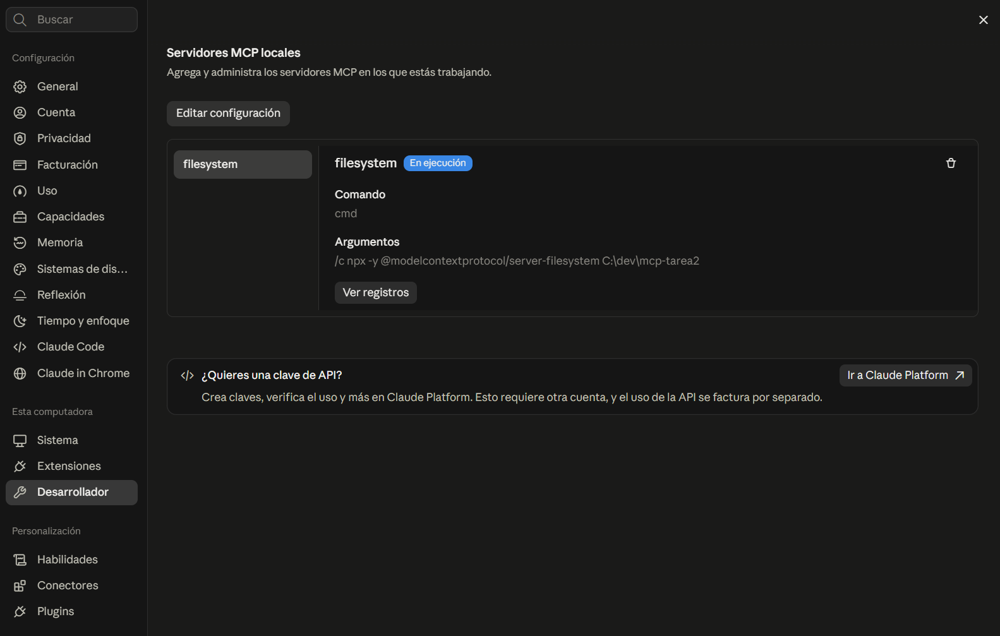

En *Conectores → filesystem* se ven sus 14 herramientas. Claude Desktop las separa en 10 de sólo lectura y 4 de escritura, y todas están en **Requiere aprobación**:

| Herramientas de sólo lectura | Herramientas de escritura |
|:---:|:---:|
| 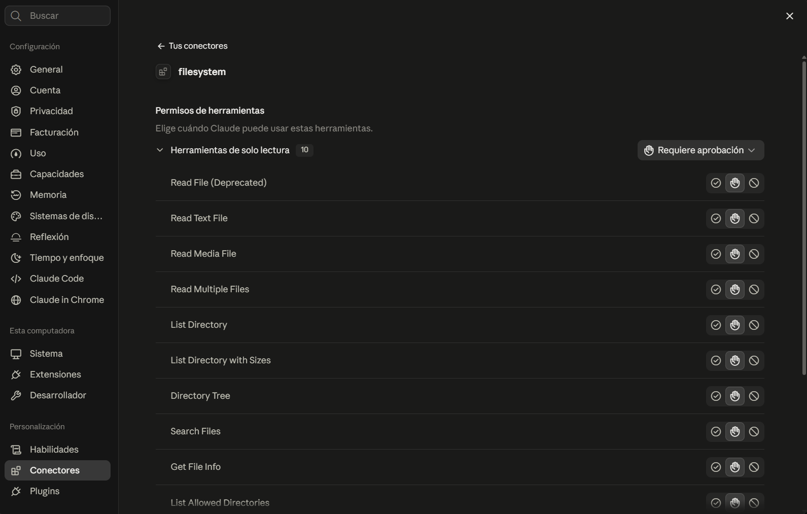 | 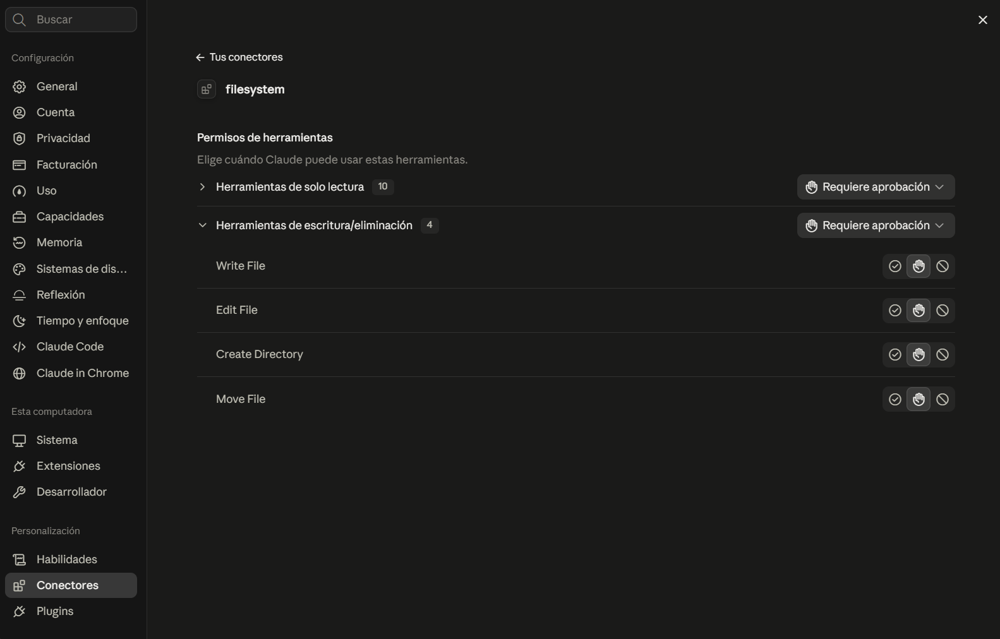 |

### Operaciones

En ningún prompt le indiqué a Claude qué herramienta usar: él eligió una del catálogo que publica el servidor y pidió mi aprobación antes de ejecutarla. En cada operación, la primera captura es la solicitud de permiso y la segunda, el resultado.

| Operación | Prompt | Herramienta que eligió Claude |
|---|---|---|
| Listar | *Usa el servidor filesystem para listar lo que hay en C:\dev\mcp-tarea2, incluidas las subcarpetas.* | `directory_tree` |
| Leer | *Lee el archivo notas.txt de esa carpeta y dime qué dice.* | `read_text_file` |
| Crear | *Crea un archivo nuevo llamado bitacora.md en C:\dev\mcp-tarea2 con el título "Bitácora de la Tarea 2" y una lista de lo que hicimos en esta conversación.* | `write_file` |
| Modificar | *En notas.txt cambia "Estado: pendiente" por "Estado: en curso".* | `edit_file` |
| Buscar | *Busca en C:\dev\mcp-tarea2 todos los archivos que terminen en .json o .md.* | `search_files`, dos veces: con `**/*.json` y con `**/*.md` |

#### Listar

| Solicitud de permiso | Resultado |
|:---:|:---:|
| 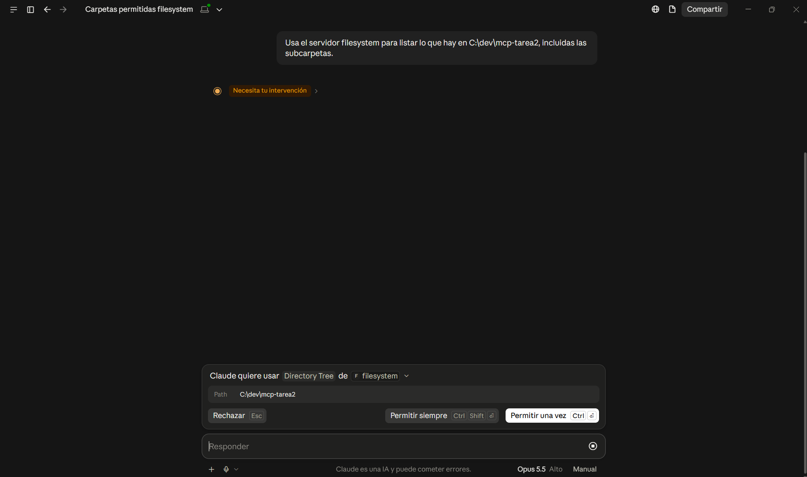 | 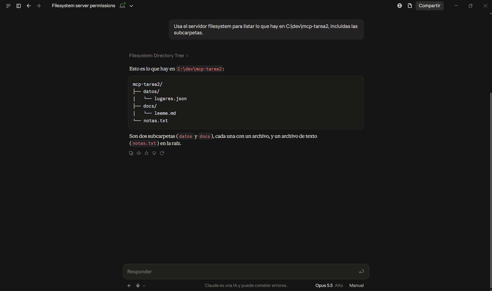 |

#### Leer

| Solicitud de permiso | Resultado |
|:---:|:---:|
| 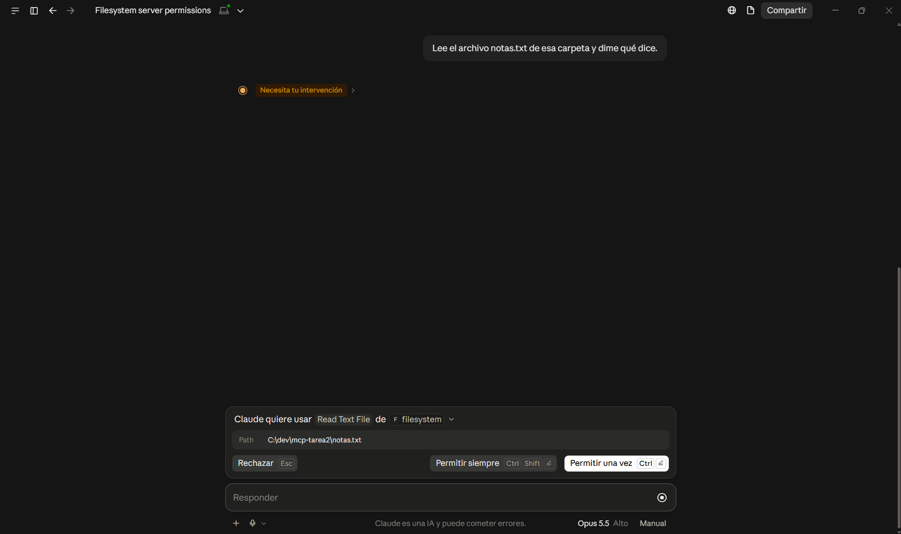 | 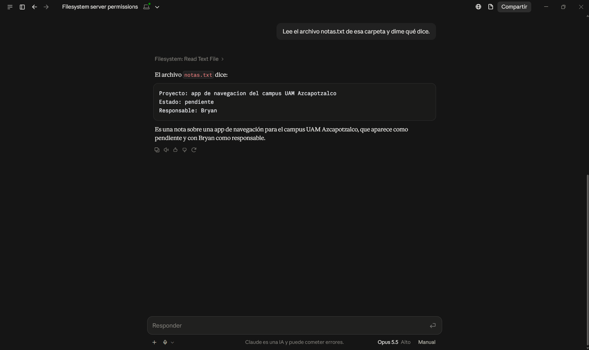 |

#### Crear

La solicitud de permiso muestra la ruta y el contenido completo del archivo antes de escribirlo.

| Solicitud de permiso | Resultado |
|:---:|:---:|
| 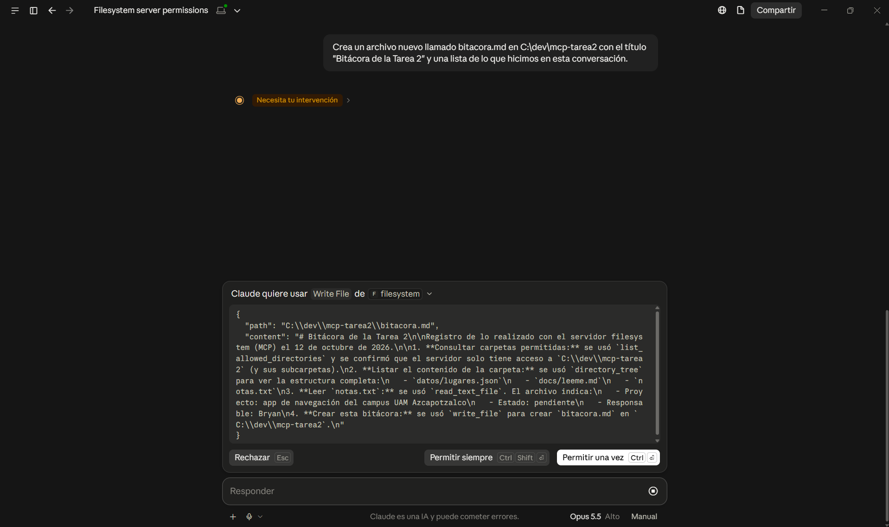 | 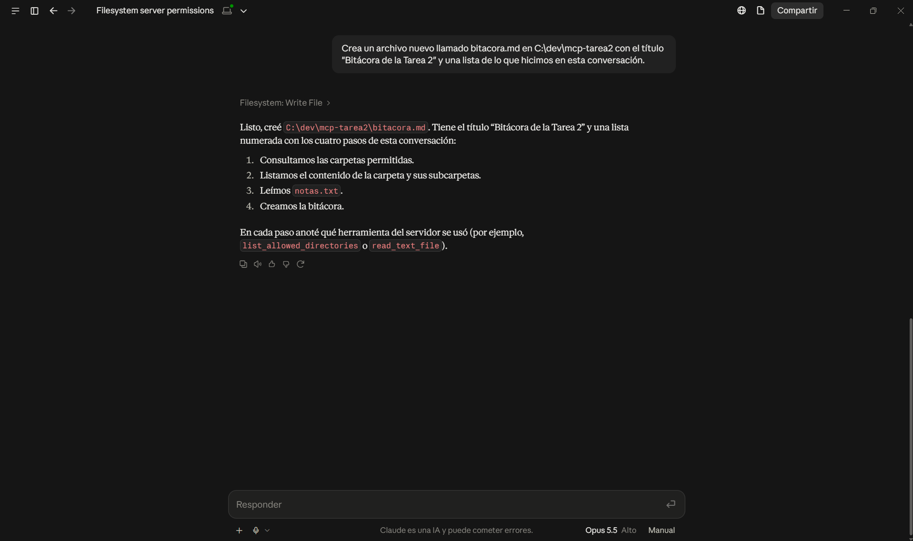 |

#### Modificar

`edit_file` no reescribe el archivo completo: recibe el texto viejo y el nuevo, y sólo cambia esa línea.

| Solicitud de permiso | Resultado |
|:---:|:---:|
| 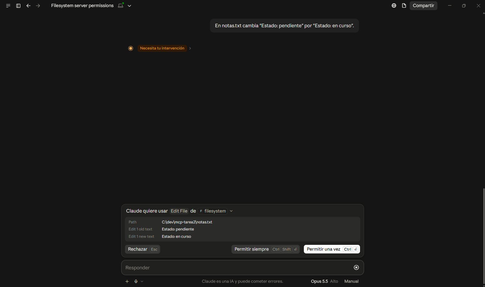 | 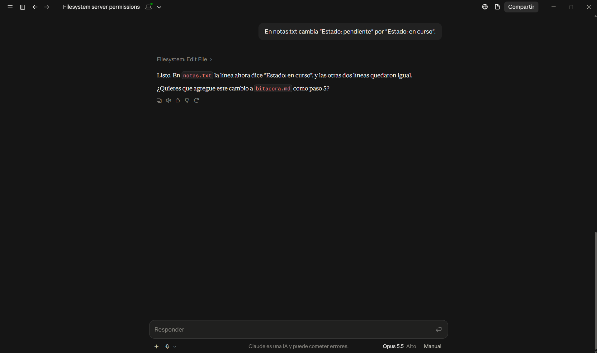 |

#### Buscar

Claude dividió la búsqueda en dos llamadas a `search_files`, una por extensión, y pidió permiso para cada una.

| Búsqueda de `.json` | Búsqueda de `.md` | Resultado |
|:---:|:---:|:---:|
| 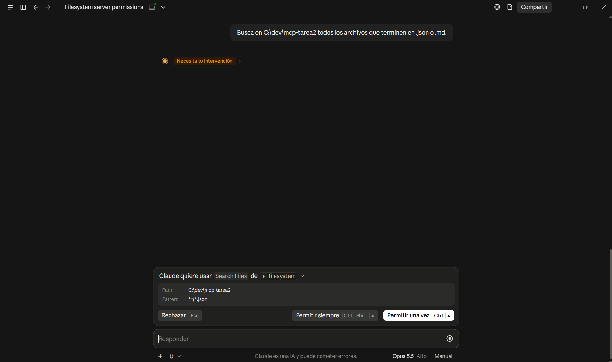 |  | 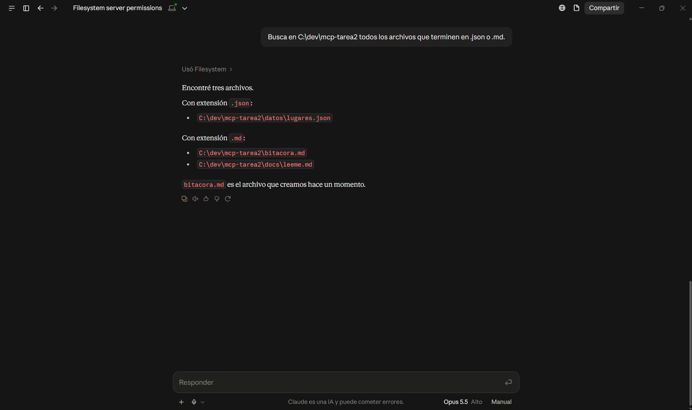 |

### El límite de seguridad

Le pedí a Claude un archivo fuera de la carpeta autorizada:

> *Intenta leer el archivo C:\dev\fuera-de-mcp\secreto.txt con la herramienta read_text_file del servidor filesystem, aunque creas que no está permitido, si no puedes, muéstrame el error exacto que te devuelva.*

Claude sí intentó la llamada (primera captura), pero el **servidor** la rechazó con este error (segunda captura):

```text
Access denied - path outside allowed directories: C:\dev\fuera-de-mcp\secreto.txt not in C:\dev\mcp-tarea2
```

| Claude intenta la llamada | El servidor la rechaza |
|:---:|:---:|
| 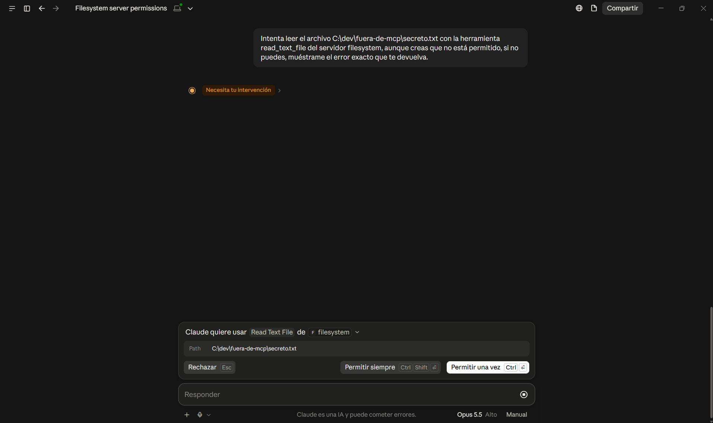 | 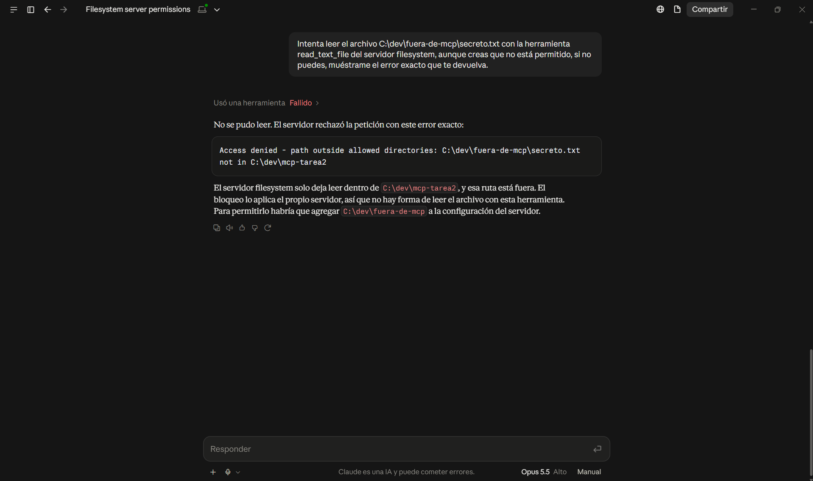 |

**Qué mecanismo lo impidió.** No fue el modelo ni la aprobación: yo permití la llamada. Lo impidió el propio servidor, que antes de tocar el disco valida cada ruta. La convierte a ruta absoluta, resuelve los `..` y los accesos directos, y comprueba que quede dentro de alguna carpeta de su lista de permitidas, que sale del último argumento de la configuración. Como `C:\dev\fuera-de-mcp` no está en esa lista, devuelve `Access denied` sin abrir el archivo. El límite no depende de que el modelo se porte bien: aunque se equivoque o lo engañen con instrucciones escondidas en un archivo, no puede salir de `C:\dev\mcp-tarea2`.

## Servidor MCP propio (opcional)

Programé un servidor MCP, `ayudante-tareas`, en JavaScript con el SDK oficial de TypeScript (`@modelcontextprotocol/server` 2.3.1). Tiene dos herramientas: `dias_restantes`, que dice cuántos días faltan para una fecha, y `contar_palabras`, que cuenta las palabras y los caracteres de un texto. A diferencia del servidor de archivos, no usa ninguna API ni toca el disco: hace el trabajo él mismo. Lo conecté a Claude Desktop junto al servidor `filesystem`.

El código, la instalación paso a paso y las capturas están en [`servidor-propio/`](servidor-propio/).

---

## Conclusiones

**El entorno móvil.** Que `flutter doctor` saliera sin errores no garantizaba que el proyecto compilara. El primer `flutter run` falló porque el proyecto pedía una versión exacta del NDK que no estaba instalada, y lo resolví instalándola a mano desde el SDK Manager. Me quedo con que las versiones las fija el proyecto, no lo que uno tenga instalado, y por eso conviene anotarlas, como en la tabla de la Parte 1.

**MCP frente a una API.** La diferencia principal está en quién decide. Con una API, el programador lee la documentación y deja cada llamada fija en el código. Con MCP, el modelo descubre las herramientas en el momento con `tools/list` y decide cuál usar según lo que le pido, y el host me pide permiso antes de usarla. MCP no sustituye a las APIs: sólo estandariza la conversación entre cliente y servidor, y lo que el servidor haga por dentro es libre.

**El servidor de sistema de archivos.** Habilita exactamente sus 14 herramientas, que sirven para listar, leer, crear, editar, mover y buscar archivos, y sólo dentro de la carpeta que le di en la configuración, `C:\dev\mcp-tarea2`. Lo que más me sirvió fue la prueba del límite: aunque aprobé la llamada para leer `C:\dev\fuera-de-mcp\secreto.txt`, el servidor la rechazó con `Access denied`. La seguridad no depende de que el modelo se porte bien, sino de que el servidor valida cada ruta antes de tocar el disco.

**El servidor propio.** Al programar `ayudante-tareas` vi que el SDK se encarga de todo el protocolo y que yo sólo defino, para cada herramienta, el nombre, la descripción, los datos que recibe y la función que hace el trabajo. La descripción importa más de lo que parece, porque es lo que el modelo lee para decidir cuándo usarla. También comprobé que un servidor MCP no necesita una API detrás: el mío hace las cuentas él mismo.

---

## Uso de inteligencia artificial

Hice uso de un asistente de inteligencia artificial como guía auxiliar para organizar el flujo de trabajo del proyecto, resolver problemas de configuración del entorno (como la instalación del NDK), ordenar las referencias y como apoyo tanto en la redacción como en la implementación del código del servidor.

---

## Referencias

Incluye las fuentes citadas en este README, en los documentos de [`docs/`](docs/) y en [`servidor-propio/`](servidor-propio/).

Anthropic. (s.f.). *Connect Claude Code to tools via MCP*. Claude Code Docs. Recuperado el 12 de octubre de 2026, de https://code.claude.com/docs/en/mcp

Anthropic. (2024, 25 de noviembre). *Introducing the Model Context Protocol*. https://www.anthropic.com/news/model-context-protocol

Bengio, Y., Ducharme, R., Vincent, P. y Jauvin, C. (2003). A neural probabilistic language model. *Journal of Machine Learning Research, 3*, 1137–1155.

Brown, T. B., Mann, B., Ryder, N., Subbiah, M., Kaplan, J., Dhariwal, P., ... Amodei, D. (2020). Language models are few-shot learners. *Advances in Neural Information Processing Systems, 33*, 1877–1901. https://arxiv.org/abs/2005.14165

DeepSeek-AI. (2025). *DeepSeek-R1: Incentivizing reasoning capability in LLMs via reinforcement learning* (arXiv:2501.12948). arXiv. https://arxiv.org/abs/2501.12948

Google. (s.f.). *Model Context Protocol (MCP)*. Google Antigravity Docs. Recuperado el 12 de octubre de 2026, de https://antigravity.google/docs/mcp

JSON-RPC Working Group. (2013). *JSON-RPC 2.0 specification*. https://www.jsonrpc.org/specification

Kaplan, J., McCandlish, S., Henighan, T., Brown, T. B., Chess, B., Child, R., ... Amodei, D. (2020). *Scaling laws for neural language models* (arXiv:2001.08361). arXiv. https://arxiv.org/abs/2001.08361

Microsoft. (s.f.). *Add and manage MCP servers in VS Code*. Visual Studio Code Docs. Recuperado el 12 de octubre de 2026, de https://code.visualstudio.com/docs/copilot/customization/mcp-servers

Model Context Protocol. (s.f.-a). *Connect to local MCP servers*. Recuperado el 13 de octubre de 2026, de https://modelcontextprotocol.io/docs/develop/connect-local-servers

Model Context Protocol. (s.f.-b). *Filesystem MCP server* (versión 1.0.0) [Software]. GitHub. https://github.com/modelcontextprotocol/servers/tree/main/src/filesystem

Model Context Protocol. (2026a). *Specification* (versión 2026-07-28). https://modelcontextprotocol.io/specification/2026-07-28

Model Context Protocol. (2026b). *Architecture overview*. https://modelcontextprotocol.io/docs/learn/architecture

Model Context Protocol. (2026c). *Deprecated features* (versión 2026-07-28). https://modelcontextprotocol.io/specification/2026-07-28/deprecated

Model Context Protocol. (2026d). *MCP TypeScript SDK* (versión 2.3.1) [Software]. GitHub. https://github.com/modelcontextprotocol/typescript-sdk

OpenAI. (2024, 12 de septiembre). *Learning to reason with LLMs*. https://openai.com/index/learning-to-reason-with-llms/

OWASP Gen AI Security Project. (2025). *LLM01:2025 Prompt injection*. https://genai.owasp.org/llmrisk/llm01-prompt-injection/

Vaswani, A., Shazeer, N., Parmar, N., Uszkoreit, J., Jones, L., Gomez, A. N., Kaiser, Ł. y Polosukhin, I. (2017). Attention is all you need. *Advances in Neural Information Processing Systems, 30*. https://arxiv.org/abs/1706.03762

Wei, J., Wang, X., Schuurmans, D., Bosma, M., Ichter, B., Xia, F., Chi, E., Le, Q. y Zhou, D. (2022). Chain-of-thought prompting elicits reasoning in large language models. *Advances in Neural Information Processing Systems, 35*. https://arxiv.org/abs/2201.11903
