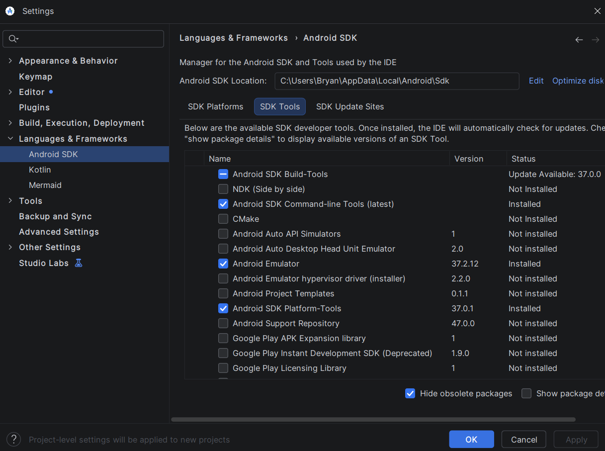
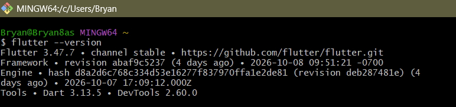
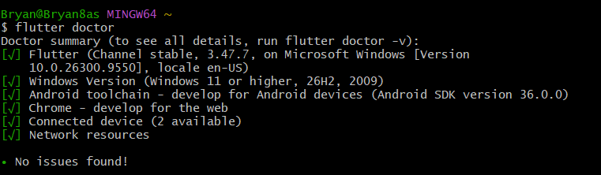
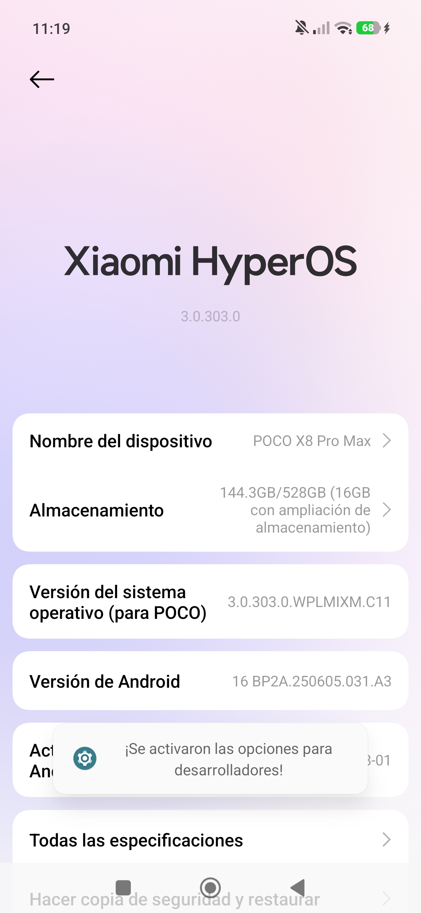
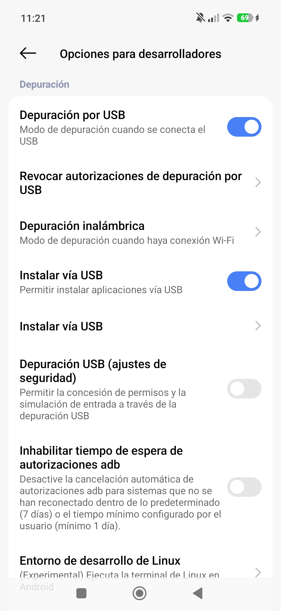
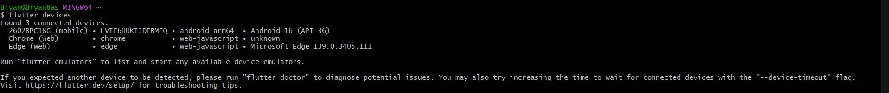
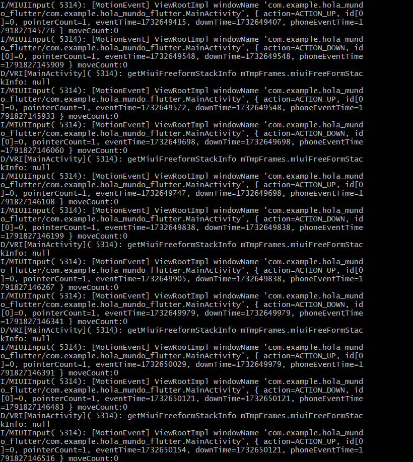
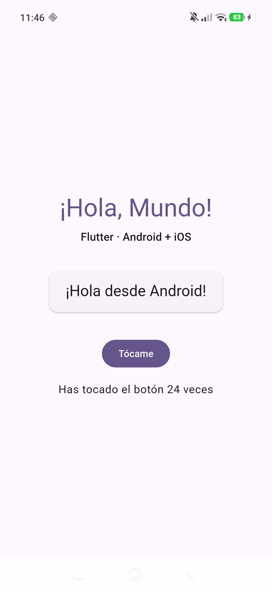
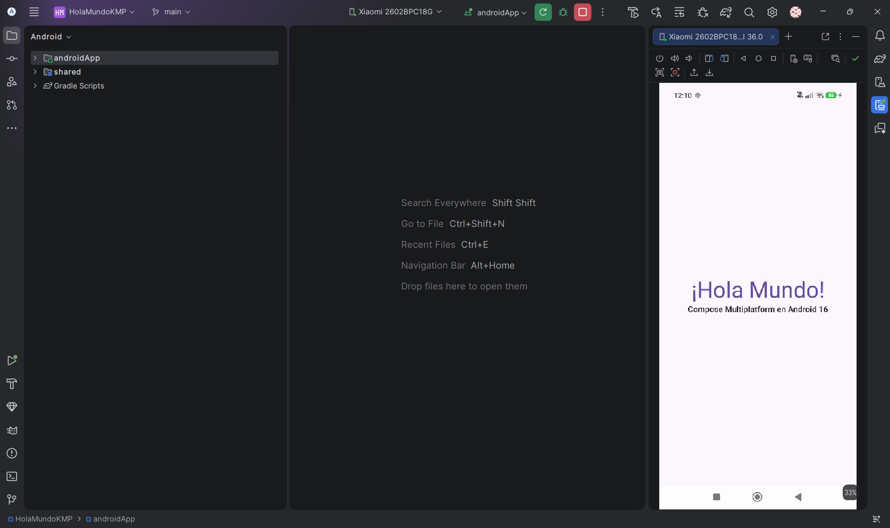

# Tarea 2 · Entorno móvil e inteligencia artificial con MCP

| | |
|---|---|
| **UEA y clave** | Administración de Proyectos de Software (1151055) |
| **Trimestre** | 26-O, otoño 2026 |
| **Licenciatura** | Ingeniería en Computación |
| **Nombre** | Bryan Tonatiuh Ochoa De La Cruz |
| **Matrícula** | 2223028771 |
| **Profesor** | Gabriel Hurtado Avilés |

## Contenido

1. [Parte 1 · El entorno de desarrollo móvil](#parte-1--el-entorno-de-desarrollo-móvil)

---

## Parte 1 · El entorno de desarrollo móvil

Instalé Flutter y Android Studio en Windows 11 y corrí las dos apps de ejemplo del curso, [HolaMundoFlutter](https://github.com/gabrielhuav/Flutter-Projects/tree/main/HolaMundoFlutter) y [HolaMundoKMP](https://github.com/gabrielhuav/HolaMundoKMP), en un **teléfono físico**, un Poco X8 Pro Max conectado por USB. No usé emulador.

### Versiones instaladas

| Pieza | Versión |
|---|---|
| Sistema operativo | Windows 11 26H2 (compilación 10.0.26300.9550) |
| Android Studio | Rabbit 1 \| 2026.2.1 (build AI-262.9437.185.2621.16467767), con JDK 25.0.3 incluido |
| Flutter | 3.47.7, channel stable (revisión abaf9c5237) |
| Dart | 3.13.5 |
| SDK de Android | Android SDK 36.0.0 · Platform android-37.0 · Build-Tools 36.0.0 |
| NDK de Android | 28.2.13676358 (r28c) |
| Dispositivo | Poco X8 Pro Max (modelo 2602BPC18G) |
| Android del dispositivo | Android 16 (API 36), compilación BP2A.250605.031.A3 · HyperOS 3.0.303.0 |

### 1. Android Studio y el SDK Manager

En *Settings → Languages & Frameworks → Android SDK*, pestaña *SDK Tools*, con **Android SDK Command-line Tools (latest)** instaladas. Sin ellas, `flutter doctor` marca la línea de Android toolchain con un error.

### 2. Flutter y Dart

### 3. flutter doctor

Flutter y Android toolchain aparecen con [√], y `flutter doctor` termina con *No issues found!*

### 4. El teléfono en modo desarrollador

En HyperOS, las opciones de desarrollador se activan tocando siete veces la versión de HyperOS en *Ajustes → Sobre el teléfono*, no el número de compilación. Además de **Depuración por USB**, en los Xiaomi y Poco hay que activar **Instalar vía USB**; sin ella, Flutter no puede instalar la app en el teléfono.

| Opciones de desarrollador activadas | Depuración por USB e Instalar vía USB |
|:---:|:---:|
|  |  |

El teléfono aparece en `flutter devices` como `2602BPC18G`, con Android 16 (API 36):

### 5. HolaMundoFlutter en el teléfono

Desde `C:\dev\Flutter-Projects\HolaMundoFlutter`, con `flutter pub get` y `flutter run`. La terminal registra los toques que recibe la app en el teléfono, y el contador sube con cada uno.

| Salida de `flutter run` | La app en el teléfono |
|:---:|:---:|
|  |  |

### 6. HolaMundoKMP desde Android Studio

Abrí la carpeta raíz `HolaMundoKMP` en Android Studio y, después del Gradle sync, elegí la configuración `androidApp` y el teléfono (`Xiaomi 2602BPC18G`) y pulsé ▶ Run. A la derecha, el espejo del dispositivo muestra la app corriendo en el teléfono.

### Problemas que encontré

| Problema | Causa | Solución |
|---|---|---|
| La primera vez, `flutter run` falló con `Android sdkmanager did not install NDK 28.2.13676358` | El proyecto necesita el NDK de Android y Gradle intentó instalarlo solo, pero la herramienta `sdkmanager` ya está obsoleta y su reemplazo no encontró el paquete | Instalar el NDK 28.2.13676358 por separado, desde *SDK Manager → SDK Tools → Show Package Details → NDK (Side by side)*, y repetir `flutter run` |
