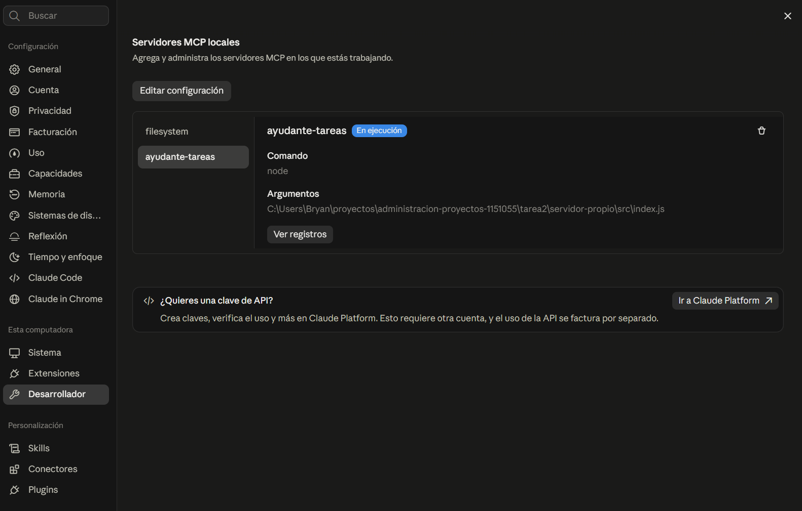
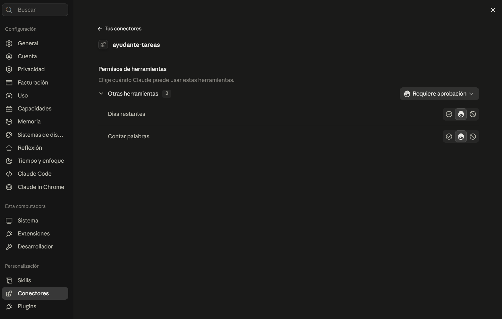
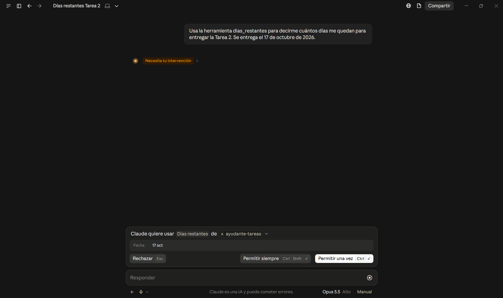
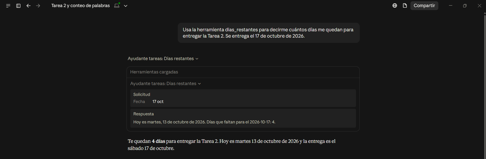
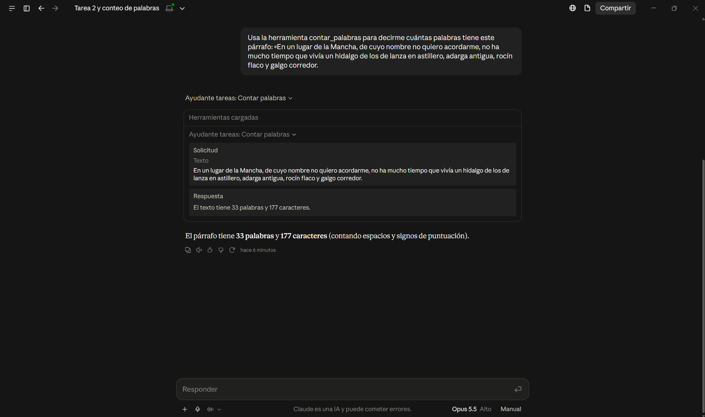

# Servidor MCP propio: `ayudante-tareas`

Parte opcional de la Tarea 2. Es un servidor MCP con dos herramientas sencillas que me sirven para las tareas de la carrera:

| Herramienta | Qué recibe | Qué responde |
|---|---|---|
| `dias_restantes` | Una fecha límite (`AAAA-MM-DD`) | Qué día es hoy y cuántos días faltan para esa fecha |
| `contar_palabras` | Un texto | Cuántas palabras y caracteres tiene |

Las escogí porque son dos cuentas que el modelo hace de memoria y en las que se puede equivocar. El modelo no tiene reloj: en Claude Desktop sabe la fecha porque la app se la pasa al empezar el chat, pero la resta de días la hace él mismo. Con `dias_restantes`, el servidor toma la fecha del reloj de la computadora y el código hace la resta exacta. Con las palabras pasa algo parecido: en un texto largo el modelo suele contar mal, y el servidor las cuenta exactas.

Este servidor no usa ninguna API ni toca el disco: **resuelve los pedidos él mismo**. Es el tercer caso de la tabla de [docs/03](../docs/03-mcp-frente-a-una-api.md#mcp-no-sustituye-a-las-apis).

## Cómo está hecho

| Elemento | Versión |
|---|---|
| SDK oficial de TypeScript para servidores, `@modelcontextprotocol/server` | 2.3.1 (implementa la especificación 2026-07-28) |
| `zod`, para describir y validar los datos que recibe cada herramienta | 4.6.7 |
| Node.js | 20 o posterior (yo uso v26.8.1) |
| Transporte | stdio |

Todo el servidor está en un solo archivo, [`src/index.js`](src/index.js). Está en JavaScript para no tener que compilar; el SDK de TypeScript se usa igual desde JavaScript.

El SDK se encarga del protocolo, es decir, de recibir y contestar los mensajes JSON-RPC. Sólo defino las herramientas. Cada una se registra con `server.registerTool` y lleva cuatro cosas:

1. **Nombre**, por ejemplo `dias_restantes`.
2. **Descripción**: lo que lee el modelo para decidir cuándo usarla.
3. **Esquema de entrada** con `zod`: qué datos recibe. Por ejemplo, `fecha` tiene que ser un texto con forma `AAAA-MM-DD`. Si no la cumple, el SDK rechaza la llamada antes de ejecutar la función.
4. **Función**: hace el trabajo y devuelve el resultado como texto.

Al final, `serveStdio(crearServidor)` arranca el servidor y lo deja escuchando por stdio.

Con eso, cuando Claude Desktop pide `tools/list`, el SDK le manda el nombre, la descripción y el esquema de las dos herramientas. Cuando Claude decide usar una, llega un `tools/call` y el SDK ejecuta la función que le corresponde.

## Instalación paso a paso

Probado en Windows 11 con Git Bash y Claude Desktop 2.31226.1, con el servidor de archivos de la Parte 3 ya configurado.

1. **Instalar las dependencias.** En Git Bash, dentro de la carpeta del servidor:

   ```bash
   cd ~/proyectos/administracion-proyectos-1151055/tarea2/servidor-propio
   npm install
   ```

   Esto descarga el SDK y `zod` en `node_modules/`, que no se sube al repositorio (está en `.gitignore`).

2. **Registrar el servidor en Claude Desktop.** En *Configuración → Desarrollador → Editar configuración* se abre `claude_desktop_config.json`; ahí se agrega `ayudante-tareas` junto a `filesystem`. El archivo completo también está en [`claude_desktop_config.json`](claude_desktop_config.json):

   ```json
   {
     "mcpServers": {
       "filesystem": {
         "command": "cmd",
         "args": ["/c", "npx", "-y", "@modelcontextprotocol/server-filesystem", "C:\\dev\\mcp-tarea2"]
       },
       "ayudante-tareas": {
         "command": "node",
         "args": ["C:\\Users\\Bryan\\proyectos\\administracion-proyectos-1151055\\tarea2\\servidor-propio\\src\\index.js"]
       }
     }
   }
   ```

   La ruta debe ser absoluta y con `\\`. Aquí no hace falta `cmd /c`, porque `node` es un ejecutable normal; `npx` sí lo necesita en Windows.

3. **Reiniciar Claude Desktop** saliendo por completo (**☰ → Archivo → Salir**) y volviéndolo a abrir.

4. **Comprobar que aparece.** En *Configuración → Desarrollador*, `ayudante-tareas` debe aparecer **En ejecución**, y en *Conectores → ayudante-tareas* se ven sus dos herramientas.

## Prueba en Claude Desktop

En las preguntas pido usar la herramienta por su nombre. Si no, Claude a veces contesta de memoria sin llamar al servidor, justo lo que la herramienta busca evitar.

Para probar `dias_restantes` le pregunté a Claude, el martes 13 de octubre de 2026:

> Usa la herramienta dias_restantes para decirme cuántos días me quedan para entregar la Tarea 2. Se entrega el 17 de octubre de 2026.

Claude convirtió la fecha a `2026-10-17` y pidió permiso para usar *Días restantes* de `ayudante-tareas`; en la ventana de permiso se ve la fecha que iba a mandar. Lo aprobé con *Permitir una vez*, el servidor leyó la fecha de mi computadora y Claude respondió que me quedan **4 días**: hoy es martes 13 de octubre y la entrega es el sábado 17. Al desplegar el bloque de la herramienta se ven la *Solicitud* que mandó Claude y la *Respuesta* tal como la escribió mi servidor: «Hoy es martes, 13 de octubre de 2026. Días que faltan para el 2026-10-17: 4.» Así se comprueba que la cuenta la hizo el servidor y no el modelo.

Para probar `contar_palabras` usé el inicio del *Quijote*:

> Usa la herramienta contar_palabras para decirme cuántas palabras tiene este párrafo: «En un lugar de la Mancha, de cuyo nombre no quiero acordarme, no ha mucho tiempo que vivía un hidalgo de los de lanza en astillero, adarga antigua, rocín flaco y galgo corredor.

El servidor respondió **33 palabras y 177 caracteres**, contando espacios y signos de puntuación.

## Capturas











## Referencias

Model Context Protocol. (2026). *MCP TypeScript SDK* (versión 2.3.1) [Software]. GitHub. https://github.com/modelcontextprotocol/typescript-sdk
